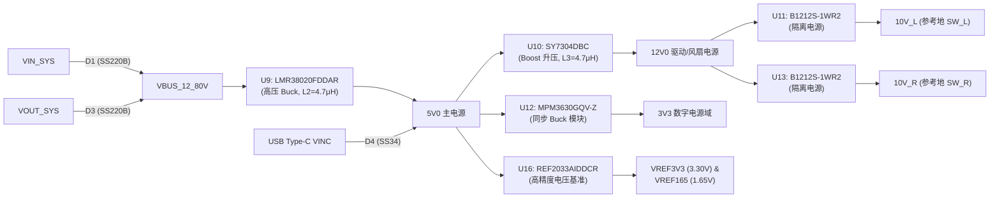

# 下板（功率板 V6）硬件原理图拓扑与引脚连接总结

- **工程名称**：`UF4DigitalPower V2_copy`
- **单板名称**：下板 / 功率板 V6 (`V1.6`)
- **主控芯片**：`STM32G474RBT6` (LQFP64, `U20`)
- **源文件**：`Doc/SCH_下板_2026-11-02.pdf`（共 4 页：TUPO、POWER、COLLECT、MCU）

---

## 1. MCU (`STM32G474RBT6` - `U20`) 引脚分配总表

> **说明**：表中包含原理图网络名、芯片引脚号、连接目标器件及软件计算/配置关键参数，方便直接生成代码或核对配置。

| MCU 引脚 | Pin# | 原理图网络标签 | 信号方向 / 类型 | 复用功能建议 | 连接目标器件与电路说明 |
| :--- | :---: | :--- | :---: | :--- | :--- |
| **PA0** | 12 | `IIN_L` (`I_ADC_I`) | Analog In | `ADC1_IN1` / `ADC2_IN1` | 输入电流采样 `U14` (INA240A1) Pin 8 (`OUT`) |
| **PA1** | 13 | `IIN_H` (`I_ADC_I`) | Analog In | `ADC1_IN2` / `ADC2_IN2` | 与 `PA0` 并联接 `I_ADC_I`（可用于双通道/过零比较或高/低阈值检测） |
| **PA2** | 14 | `USART2_TX` | Digital Out | `USART2_TX` | 连接至板间 `FPC1` (Pin 2)，用于与上板串口通信 |
| **PA3** | 17 | `USART2_RX` | Digital In | `USART2_RX` | 连接至板间 `FPC1` (Pin 3)，用于与上板串口通信 |
| **PA5** | 19 | `FAN_CESU` | Digital In | `GPIO` / `TIM2_CH1` | 风扇测速反馈，接风扇接口 `U23` Pin 4（带 `R46=10kΩ` 上拉至 `3V3`） |
| **PA6** | 20 | `FAN_PWN` | Digital Out | `TIM3_CH1` / `TIM16_CH1` | 风扇 PWM 控制，接风扇接口 `U23` Pin 3 及三极管 `Q5` (S8050) 基极 (`R53=1kΩ`) |
| **PA7** | 21 | `VIN_ADC` (`V_ADC_I`) | Analog In | `ADC2_IN4` | 输入电压采样，接差分运放 `U2.2` (GS8558) Pin 7 |
| **PA8** | 42 | `TEMP2` | Analog In | `ADC5_IN1` | NTC 温度采样 2，接 `R39` (10k NTC, B=3380) 与 `R42` (10kΩ) 分压点 |
| **PA9** | 43 | `TEMP1` | Analog In | `ADC5_IN2` | NTC 温度采样 1，接 `R40` (10k NTC, B=3380) 与 `R43` (10kΩ) 分压点 |
| **PA11** | 45 | `USB_DM` (`TO_UPPER_DM`) | USB D- | `USB_DM` | 连接 `USB1` (Type-C) `A7/B7` 引脚 |
| **PA12** | 46 | `USB_DP` (`TO_UPPER_DP`) | USB D+ | `USB_DP` | 连接 `USB1` (Type-C) `A6/B6` 引脚 |
| **PA13** | 49 | `SYS_JTMS-SWDIO` (`MCU1_SWDIO`) | Debug I/O | `SYS_JTMS-SWDIO` | 连接 `H1` 调试座 Pin 4 及 `FPC1` Pin 5 |
| **PA14** | 50 | `SYS_JTCK-SWCLK` (`MCU1_SWCLK`) | Debug In | `SYS_JTCK-SWCLK` | 连接 `H1` 调试座 Pin 3 及 `FPC1` Pin 6 |
| **PB0** | 24 | `VOUT_ADC` (`V_ADC_O`) | Analog In | `ADC1_IN15` / `ADC3_IN12` | 输出电压采样，接差分运放 `U1.2` (GS8558) Pin 7 |
| **PB1** | 25 | `RGB1` | Digital Out | `GPIO_Output` | 板载状态指示灯 `RGB1`（高电平点亮，串联 `R38=3kΩ` 接地） |
| **PB2** | 26 | `RGB2` | Digital Out | `GPIO_Output` | 板载状态指示灯 `RGB2`（高电平点亮，串联 `R41=3kΩ` 接地） |
| **PB3** | 56 | `MCU1_SWDO` | Debug Out | `SYS_JTDO-SWO` | 连接板间 `FPC1` Pin 7 |
| **PB5** | 58 | `FDCAN_S` | Digital Out | `GPIO_Output` | CAN 收发器 `U18` (TCAN1051) Pin 8 (`S` 静音模式控制，**低电平正常工作**，高电平静音) |
| **PB8** | 61 | `FDCAN1_RX` | Digital In | `FDCAN1_RX` | CAN 收发器 `U18` (TCAN1051) Pin 4 (`RXD`) |
| **PB9** | 62 | `FDCAN1_TX` | Digital Out | `FDCAN1_TX` | CAN 收发器 `U18` (TCAN1051) Pin 1 (`TXD`) |
| **PB11** | 33 | `IOUT_H` (`I_ADC_O`) | Analog In | `ADC1_IN14` / `ADC2_IN14` | 输出电流采样 `U15` (INA240A1) Pin 8 (`OUT`)，与 `PB14` 同接 `I_ADC_O` |
| **PB12** | 34 | `VREF165` | Analog In | `ADC1_IN11` / `ADC4_IN3` | 1.65V 偏置基准电压监测，接 `U16` (REF2033) Pin 1 (`VBIAS`) |
| **PB14** | 36 | `IOUT_L` (`I_ADC_O`) | Analog In | `ADC1_IN5` / `ADC4_IN4` | 输出电流采样 `U15` (INA240A1) Pin 8 (`OUT`)，与 `PB11` 同接 `I_ADC_O` |
| **PC4** | 22 | `USART1_TX` | Digital Out | `USART1_TX` | 连接至板间 `FPC1` (Pin 11)，用于外部/上板通信 |
| **PC5** | 23 | `USART1_RX` | Digital In | `USART1_RX` | 连接至板间 `FPC1` (Pin 10)，用于外部/上板通信 |
| **PC6** | 38 | `HRTIM1_CHF1` (`PWM_H2`) | HRTIM Out | `HRTIM1_CHF1` | **右半桥（输出侧）高侧**驱动信号 → `U8` (UCC27211) Pin 5 (`HI`) → 控制 `Q2` |
| **PC7** | 39 | `HRTIM1_CHF2` (`PWM_L2`) | HRTIM Out | `HRTIM1_CHF2` | **右半桥（输出侧）低侧**驱动信号 → `U8` (UCC27211) Pin 6 (`LI`) → 控制 `Q4` |
| **PC8** | 40 | `HRTIM1_CHE1` (`PWM_H1`) | HRTIM Out | `HRTIM1_CHE1` | **左半桥（输入侧）高侧**驱动信号 → `U7` (UCC27211) Pin 5 (`HI`) → 控制 `Q1` |
| **PC9** | 41 | `HRTIM1_CHE2` (`PWM_L1`) | HRTIM Out | `HRTIM1_CHE2` | **左半桥（输入侧）低侧**驱动信号 → `U7` (UCC27211) Pin 6 (`LI`) → 控制 `Q3` |
| **PC10** | 52 | `FLASH_SCLK` | SPI SCK | `SPI3_SCK` | 外部 Flash `U22` (W25Q64) Pin 6 (`CLK`) |
| **PC11** | 53 | `FLASH_MISO` | SPI MISO | `SPI3_MISO` | 外部 Flash `U22` (W25Q64) Pin 2 (`DO/IO1`) |
| **PC12** | 54 | `FLASH_MOSI` | SPI MOSI | `SPI3_MOSI` | 外部 Flash `U22` (W25Q64) Pin 5 (`DI/IO0`) |
| **PD2** | 55 | `FLASH_NSS` | Digital Out | `GPIO_Output` | 外部 Flash `U22` (W25Q64) Pin 1 (`CS#`) |
| **PF0** | 5 | `PF0-OSC_IN` | Clock In | `RCC_OSC_IN` | 外部無源晶振 `X1` (**25MHz**)，匹配电容 `C48=10pF` |
| **PF1** | 6 | `PF1-OSC_OUT` | Clock Out | `RCC_OSC_OUT` | 外部无源晶振 `X1` (**25MHz**)，匹配电容 `C47=10pF` |
| **PG10** | 7 | `PG10-NRST` (`MCU1_NRST`) | Reset I/O | `NRST` | 复位按键、`R45=10kΩ` 上拉、`C55=100nF` 滤波，并引出至 `FPC1` Pin 4 |
| **VREF+** | 28 | `VREF3V3` | Analog Ref | `VREF+` | 接高精度基准芯片 `U16` (REF2033AIDDCR) Pin 5 输出的 **3.30V** |
| **VDDA** | 29 | `3V3` | Analog Power | `VDDA` | 接数字/系统 `3V3` 电源 |

---

## 2. 四开关 Buck-Boost 功率拓扑 (Page 1 - `TUPO`)

主功率回路采用对称的 **同步四开关 Buck-Boost (FSBB)** 拓扑，中间共用一颗功率电感：

```mermaid
flowchart LR
    VIN["VIN_D (XT30 U3/U4)"] --> R1["R1 (8mΩ)<br/>VIN_N / VIN_P"]
    R1 --> VIN_SYS["VIN_SYS 母线<br/>(4x100uF + 4x10uF + 4x100nF)"]
    VIN_SYS --> HB1["左半桥 (输入侧)<br/>高侧 Q1 / 低侧 Q3<br/>(NCEP1545G)"]
    HB1 -- "SW_R (PWM1_SW)" --> L1["主电感 22μH<br/>(XRPQ2012J-220M)"]
    L1 -- "SW_L (PWM2_SW)" --> HB2["右半桥 (输出侧)<br/>高侧 Q2 / 低侧 Q4<br/>(NCEP1545G)"]
    HB2 --> VOUT_SYS["VOUT_SYS 母线<br/>(4x100uF + 4x10uF + 4x100nF)"]
    VOUT_SYS --> R2["R2 (8mΩ)<br/>VOUT_P / VOUT_N"]
    R2 --> VOUT["VOUT_D (XT30 U5/U6)"]
```

### 2.1 功率器件与半桥驱动映射
- **输入/输出接口**：
  - 输入侧：`U3`, `U4` (T34069 / XT30 接口)，正极为 `VIN_D`，负极为 `PGND`。
  - 输出侧：`U5`, `U6` (T34069 / XT30 接口)，正极为 `VOUT_D`，负极为 `PGND`。
- **电流采样电阻**：
  - 输入侧串联在正极母线：`R1 = 8mΩ`（电源侧端点为 `VIN_N`，母线电容侧端点为 `VIN_P`）。
  - 输出侧串联在正极母线：`R2 = 8mΩ`（母线电容侧端点为 `VOUT_P`，输出端口侧端点为 `VOUT_N`）。
- **主功率电感**：`22μH` (`XRPQ2012J-220M`)，连接在左桥臂中点 `SW_R` (`PWM1_SW`) 与右桥臂中点 `SW_L` (`PWM2_SW`) 之间。
- **左半桥（输入侧，HRTIM Timer E 控制）**：
  - **栅极驱动器 `U7` (`UCC27211`)**：`VDD` 接 `12V0`，高侧自举供电引脚 `HB` 直接由隔离电源提供 `10V_R`（配合 `C27=100nF` 接至 `HS`/`PWM1_SW`，支持 100% 占空比常开！）。
  - **高侧 MOS `Q1` (`NCEP1545G`, 150V/45A)**：
    - `PC8` (`HRTIM1_CHE1` / `PWM_H1`) → `U7` Pin 5 (`HI`) → Pin 3 (`HO` / `PWM1_HO`) → 栅极电阻 `R3=2Ω`（下拉 `R5=10kΩ` 到 `SW_R`）→ `Q1` Gate。
    - `Q1` Drain 接 `VIN_SYS`，Source 接 `SW_R` (`PWM1_SW`)。
  - **低侧 MOS `Q3` (`NCEP1545G`, 150V/45A)**：
    - `PC9` (`HRTIM1_CHE2` / `PWM_L1`) → `U7` Pin 6 (`LI`) → Pin 8 (`LO` / `PWM1_LO`) → 栅极电阻 `R7=2Ω`（下拉 `R9=10kΩ` 到 `PGND`）→ `Q3` Gate。
    - `Q3` Drain 接 `SW_R` (`PWM1_SW`)，Source 接 `PGND`。
- **右半桥（输出侧，HRTIM Timer F 控制）**：
  - **栅极驱动器 `U8` (`UCC27211`)**：`VDD` 接 `12V0`，高侧自举供电引脚 `HB` 直接由隔离电源提供 `10V_L`（配合 `C28=100nF` 接至 `HS`/`PWM2_SW`，同样支持 100% 占空比常开！）。
  - **高侧 MOS `Q2` (`NCEP1545G`, 150V/45A)**：
    - `PC6` (`HRTIM1_CHF1` / `PWM_H2`) → `U8` Pin 5 (`HI`) → Pin 3 (`HO` / `PWM2_HO`) → 栅极电阻 `R4=2Ω`（下拉 `R6=10kΩ` 到 `SW_L`）→ `Q2` Gate。
    - `Q2` Drain 接 `VOUT_SYS`，Source 接 `SW_L` (`PWM2_SW`)。
  - **低侧 MOS `Q4` (`NCEP1545G`, 150V/45A)**：
    - `PC7` (`HRTIM1_CHF2` / `PWM_L2`) → `U8` Pin 6 (`LI`) → Pin 8 (`LO` / `PWM2_LO`) → 栅极电阻 `R8=2Ω`（下拉 `R10=10kΩ` 到 `PGND`）→ `Q4` Gate。
    - `Q4` Drain 接 `SW_L` (`PWM2_SW`)，Source 接 `PGND`。

> **关键硬件特性提示**：由于高侧驱动 `HB` 引脚均使用了独立隔离电源模块（`U11` / `U13`）供电，而非传统自举二极管，因此 **左右半桥的高侧 MOS (`Q1`, `Q2`) 均可維持 100% 占空比长期导通**，非常适合四开关 Buck-Boost 在纯 Buck 模式（`Q2` 常通）和纯 Boost 模式（`Q1` 常通）下工作，无需强行插入刷新脉冲。

---

## 3. 电源树架构 (Page 2 - `POWER`)

1. **双路二极管或门输入**：`VIN_SYS` 经肖特基二极管 `D1` (`SS220B`)、`VOUT_SYS` 经 `D3` (`SS220B`) 合流为 `VBUS_12_80V`（无论是正向还是反向供电均可唤醒辅助电源）。
2. **`VBUS_12_80V` → `5V0` (`U9` - `LMR38020FDDAR`)**：
   - 80V 同步 Buck，电感 `L2 = 4.7μH`，反馈电阻上管 `R13 = 120kΩ`、下管 `R15 = 30kΩ`，输出 `5V0`。
   - 同时 USB Type-C 接口的 `VINC` 也通过肖特基 `D4` (`SS34`) 馈入 `5V0`，支持仅插 USB 时给主控及采样电路供电调试。
3. **`5V0` → `12V0` (`U10` - `SY7304DBC`)**：
   - Boost 升压电路，电感 `L3 = 4.7μH`，续流肖特基 `D2` (`SS34`)，反馈电阻 `R14 = 82kΩ`、`R17 = 4.3kΩ`，输出 `12V0` 供给栅极驱动器 (`U7`, `U8`)、隔离电源 (`U11`, `U13`) 及散热风扇。
4. **`5V0` → `3V3` (`U12` - `MPM3630GQV-Z`)**：
   - 集成电感同步 Buck 电源模块，反馈电阻 `R44 = 68kΩ`、`R16 = 15kΩ`，输出 `3V3` 给 MCU 和数字外设供电。
5. **高侧悬浮隔离电源 (`U11`, `U13` - `B1212S-1WR2`)**：
   - `U11`：输入 `12V0` (`PGND`)，隔离输出正端 `10V_L`、负端接右桥臂开关节点 `SW_L`（供 `U8` 高侧驱动 `Q2`）。
   - `U13`：输入 `12V0` (`PGND`)，隔离输出正端 `10V_R`、负端接左桥臂开关节点 `SW_R`（供 `U7` 高侧驱动 `Q1`）。
6. **单点接地与电源指示灯**：
   - 功率地 `PGND` 与信号地 `GND` 通过 0Ω 电阻 `R21`, `R22` 单点连接。
   - `12V0`, `3V3`, `5V0` 均配有独立电源指示 LED。

---

## 4. 电压与电流采样调理电路 (Page 3 - `COLLECT`)

> **软件换算核心参数**：MCU 的 `VREF+` 由 `U16` (`REF2033AIDDCR`) 提供精确的 **$V_{\text{REF}} = 3.30\text{V}$**，同时 `U16` 提供 **$V_{\text{BIAS}} = \text{VREF165} = 1.65\text{V}$** 给双向电流传感器作为零点偏置。

### 4.1 基准电压源 (`U16` - `REF2033AIDDCR`)
- **供电**：`VIN` 接 `5V0`。
- **输出**：
  - Pin 5 (`VREF`) = `VREF3V3` (**3.30V**)，接 MCU 的 `VREF+` (Pin 28)。
  - Pin 1 (`VBIAS`) = `VREF165` (**1.65V**)，接 `U14`/`U15` 的基准脚，并接入 MCU `PB12` 进行实时零点校准采样。

### 4.2 电压采样电路（差分运放 + 电压跟随器）
- **输入电压采样 (`VIN_D` → `V_ADC_I` → `PA7`)**：
  - 芯片：双运放 `U2` (`GS8558-SR`，`5V0` 供电)。
  - 第一级 `U2.1` 构成差分比例衰减器：
    - 同相端 (`Pin 3`)：`VIN_D` 经 `R32 (0Ω) + R31 (75kΩ)` 接入，对地分压电阻 `R29 = 3kΩ`。
    - 反相端 (`Pin 2`)：`PGND` 经 `R33 = 75kΩ` 接入，反馈电阻 `R34 = 3kΩ`。
  - 第二级 `U2.2` 构成单位增益电压跟随器 (`Pin 5` 输入，`Pin 6` 与 `Pin 7` 短接输出)，经 `R30 = 100Ω` 输出 `V_ADC_I` 至 `PA7`。
  - **换算公式**：
    $$\text{Gain}_V = \frac{3\text{k}\Omega}{75\text{k}\Omega} = \frac{1}{25} = 0.04 \implies V_{\text{IN\_D}} = 25 \times V_{\text{ADC\_I}}$$
    （在 3.3V 满量程下，最大可测量电压为 $3.3\text{V} \times 25 = 82.5\text{V}$）。

- **输出电压采样 (`VOUT_D` → `V_ADC_O` → `PB0`)**：
  - 芯片：双运放 `U1` (`GS8558-SR`，`5V0` 供电)。
  - 第一级 `U1.1` 差分衰减器：`VOUT_D` 经 `R26 (0Ω) + R25 (75kΩ)` 及下拉 `R23 (3kΩ)`，`PGND` 经 `R27 (75kΩ)` 及反馈 `R28 (3kΩ)`。
  - 第二级 `U1.2` 电压跟随器，经 `R24 = 100Ω` 输出 `V_ADC_O` 至 `PB0`。
  - **换算公式**：与输入侧完全一致：
    $$V_{\text{OUT\_D}} = 25 \times V_{\text{ADC\_O}}$$

### 4.3 电流采样电路（`INA240A1PWR` 高侧双向电流检测）
- **器件参数**：`INA240A1PWR` 固定增益 **$G = 20\text{ V/V}$**，供电 `VS = 5V0`，`REF1` 与 `REF2` 短接并连至 `VREF165` (**1.65V**)。
- **输入电流采样 (`U14` → `I_ADC_I` → `PA0` & `PA1`)**：
  - 采样电阻：`R1 = 8mΩ`。
  - 引脚极性注意：原理图中 `U14` 的 `IN+` (Pin 2) 接 `VIN_N`（靠近输入接口 `VIN_D` 侧），`IN-` (Pin 3) 接 `VIN_P`（靠近母线电容 `VIN_SYS` 侧）。
  - 当电流从输入端口流向功率板内部（正向输入电流 $I_{\text{IN}} > 0$）时，$V_{\text{VIN\_N}} > V_{\text{VIN\_P}}$，即 $V_{\text{IN+}} > V_{\text{IN-}}$，输出电压高于 `1.65V`：
    $$V_{\text{I\_ADC\_I}} = V_{\text{REF165}} + I_{\text{IN}} \times R_1 \times G = 1.65\text{V} + I_{\text{IN}} \times 0.008\Omega \times 20 = 1.65\text{V} + 0.16 \times I_{\text{IN}}$$
    $$I_{\text{IN}} = \frac{V_{\text{I\_ADC\_I}} - V_{\text{REF165}}}{0.16} = 6.25 \times (V_{\text{I\_ADC\_I}} - V_{\text{REF165}})$$
    （满量程测量范围约为 $\pm 10.3125\text{A}$）。

- **输出电流采样 (`U15` → `I_ADC_O` → `PB11` & `PB14`)**：
  - 采样电阻：`R2 = 8mΩ`。
  - **引脚极性特别注意**：原理图中 `U15` 的 `IN+` (Pin 2) 接 `VOUT_N`（靠近输出端口 `VOUT_D` 侧），`IN-` (Pin 3) 接 `VOUT_P`（靠近母线电容 `VOUT_SYS` 侧）。
  - 当电流从功率板母线 `VOUT_SYS` 流出至负载 `VOUT_D`（正向输出电流 $I_{\text{OUT}} > 0$）时，$V_{\text{VOUT\_P}} > V_{\text{VOUT\_N}}$，即 **$V_{\text{IN+}} < V_{\text{IN-}}$，此时 `U15` 输出电压会低于基准电压 `1.65V`！**
  - **换算公式（以流出功率板为正方向）**：
    $$V_{\text{I\_ADC\_O}} = V_{\text{REF165}} - I_{\text{OUT}} \times R_2 \times G = 1.65\text{V} - 0.16 \times I_{\text{OUT}}$$
    $$I_{\text{OUT}} = \frac{V_{\text{REF165}} - V_{\text{I\_ADC\_O}}}{0.16} = 6.25 \times (V_{\text{REF165}} - V_{\text{I\_ADC\_O}})$$
    *(注：若在代码中直接用 `V_ADC - V_REF165` 计算，请注意 `U14` 与 `U15` 符号方向相反)*。

---

## 5. 外设与板间接口连接关系 (Page 4 - `MCU`)

### 5.1 NTC 温度检测 (`NTC`)
采用上拉热敏电阻 + 下拉固定电阻分压结构（温度升高 → NTC 阻值下降 → **ADC 采样电压升高**）：
- **电源**：`3V3`。
- **`TEMP2` (`PA8`)**：上拉 NTC `R39` (`103F3380`, $R_{25}=10\text{k}\Omega, B=3380\text{K}$) 接 `3V3`，下拉固定电阻 `R42 = 10kΩ` 接 `GND`。
- **`TEMP1` (`PA9`)**：上拉 NTC `R40` (`103F3380`, $R_{25}=10\text{k}\Omega, B=3380\text{K}$) 接 `3V3`，下拉固定电阻 `R43 = 10kΩ` 接 `GND`。
- **阻值与温度换算关系**：
  $$R_{\text{NTC}} = 10\text{k}\Omega \times \left(\frac{V_{\text{3V3}}}{V_{\text{TEMP}}} - 1\right)$$

### 5.2 FDCAN 接口 (`FDCAN`)
- **收发器**：`U18` (`TCAN1051VDRBRQ1`)，供电 `VCC = 5V0`，逻辑电平 `VIO = 3V3`。
- **MCU 连接**：
  - `PB9` → `FDCAN1_TX` (`U18` Pin 1 `TXD`)
  - `PB8` → `FDCAN1_RX` (`U18` Pin 4 `RXD`)
  - `PB5` → `FDCAN_S` (`U18` Pin 8 `S` 静音引脚，**需在软件中拉低 `PB5 = 0` 才能正常发送 CAN 报文**）。
- **总线终端与保护**：采用分裂终端匹配（`R36 = 60Ω` + `R37 = 60Ω`，中点经 `C43 = 4.7nF` 接地），带 `D5` (`PESD1CAN`) TVS 保护，通过 `U19` 对外连接 `CAN_H` / `CAN_L`。

### 5.3 SPI Flash 存储器 (`FLASH`)
- **芯片**：`U22` (`W25Q64JVZPIQ`, 64Mbit / 8MB Nor Flash)，`3V3` 供电。
- **引脚连接**（标准四线 SPI 模式，`IO2`/`IO3` 直接上拉至 `3V3`）：
  - `PD2` → `FLASH_NSS` (`Pin 1 CS#`)
  - `PC10` → `FLASH_SCLK` (`Pin 6 CLK`)
  - `PC11` → `FLASH_MISO` (`Pin 2 DO/IO1`)
  - `PC12` → `FLASH_MOSI` (`Pin 5 DI/IO0`)
  - `Pin 3 (IO2 / WP#)` & `Pin 7 (IO3 / HOLD#)`：直接接 `3V3`。

### 5.4 散热风扇控制 (`FAN`)
提供两种风扇接口形式，共用 `FAN_PWN` (`PA6`) 控制：
1. **双线受控风扇接口 (`FAN+` / `FAN-`)**：
   - `FAN+` 接 `12V0`，`FAN-` 接 NPN 三极管 `Q5` (`S8050`) 集电极（并反并联续流二极管 `D6` 到 `12V0`）。
   - `PA6` (`FAN_PWN`) 经 `R53 = 1kΩ` 驱动 `Q5` 基极，高电平导通。
2. **四线风扇插座 (`U23`)**：
   - Pin 1: `GND` | Pin 2: `12V0` | Pin 3: `FAN_PWN` (`PA6`) | Pin 4: `FAN_CESU` (`PA5`，带 `R46=10kΩ` 上拉至 `3V3`)。

### 5.5 USB Type-C (`TYPEC` - `USB1`) & 调试口 (`H1`)
- **`USB1` (16-Pin Type-C)**：
  - `CC1`/`CC2` 分别经 `RCC1`/`RCC2` (`5.1kΩ`) 下拉至 `GND`（请求 5V 供电）。
  - `VBUS` (`VINC`) 经肖特基 `D4` (`SS34`) 合流至 `5V0`。
  - `Dn1/Dn2` 接 `PA11` (`USB_DM`)，`Dp1/Dp2` 接 `PA12` (`USB_DP`)。
- **`H1` (4-Pin SWD 调试接口)**：
  - Pin 1: `3V3` | Pin 2: `GND` | Pin 3: `MCU1_SWCLK` (`PA14`) | Pin 4: `MCU1_SWDIO` (`PA13`)。

### 5.6 板间连接器 (`FPC_TO_BOARD` - `FPC1`)
26-Pin 0.5mm 间距 FPC 连接器 (`HC-FPC-05-LT-26RLTAG`)，用于与上板（控制/显示板）连接：

| FPC1 引脚号 | 连接网络 | 说明 |
| :---: | :--- | :--- |
| **Pin 1** | `GND` | 信号地 |
| **Pin 2** | `USART2_TX` (`PA2`) | 下板 `USART2` 发送 → 上板接收 |
| **Pin 3** | `USART2_RX` (`PA3`) | 下板 `USART2` 接收 ← 上板发送 |
| **Pin 4** | `MCU1_NRST` (`PG10`) | 下板 MCU 复位信号 |
| **Pin 5** | `MCU1_SWDIO` (`PA13`) | 下板 SWD 数据线 |
| **Pin 6** | `MCU1_SWCLK` (`PA14`) | 下板 SWD 时钟线 |
| **Pin 7** | `MCU1_SWDO` (`PB3`) | 下板 SWO 跟踪输出 |
| **Pin 8 ~ 9** | `GND` | 信号地 |
| **Pin 10** | `USART1_RX` (`PC5`) | 下板 `USART1` 接收 |
| **Pin 11** | `USART1_TX` (`PC4`) | 下板 `USART1` 发送 |
| **Pin 12 ~ 13** | `GND` | 信号地 |
| **Pin 14 ~ 16** | `3V3` | 3.3V 电源互联 |
| **Pin 17 ~ 18** | `GND` | 信号地 |
| **Pin 19 ~ 21** | `5V0` | 5.0V 电源互联 |
| **Pin 22 ~ 26** | `GND` | 信号地（含两侧固定焊盘 Pin 27, 28 接地） |

